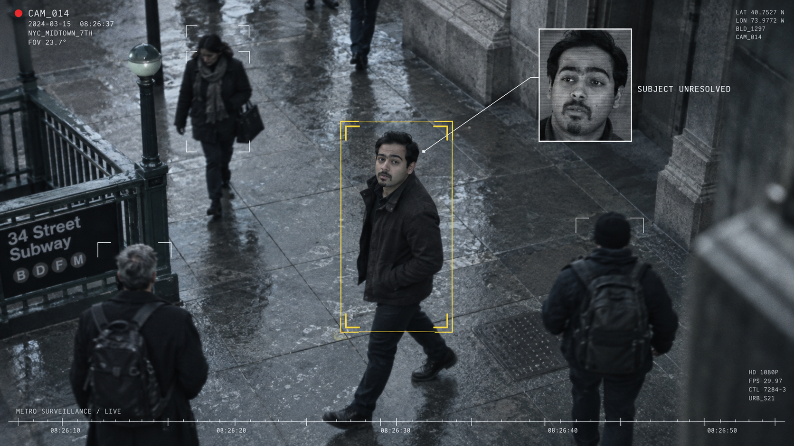

# The Unlisted

An original 39-second surveillance-thriller title sequence inspired by the visual language of *Person of Interest*, built with HyperFrames.



## Status

The editable 1920×1080, 30 fps composition and stereo soundtrack are complete. It uses generated photographic stills with animated camera reframing, tracking overlays, identity searches, and hard camera-feed cuts. It does not contain generated live-action character movement. The final MP4 has not yet been exported.

## Preview and export

Requires Node.js and npm. HyperFrames is pinned to version 0.8.156.

```sh
npm run dev
npm run check
npm run render -- --output renders/the-unlisted.mp4
```

The preview opens HyperFrames Studio. Play the root `index` composition. The first render may download browser/runtime dependencies. Keep the `assets` directory beside the source files.

## Sequence

| Time | Scene |
| --- | --- |
| 0–5 s | City surveillance network |
| 5–11 s | Lead acquired; identity unresolved |
| 11–19 s | Five related subjects |
| 19–27 s | Relationship analysis and connection loss |
| 27–34 s | Direct gaze; outside the pattern |
| 34–39 s | The Unlisted title reveal |

## Files

- `index.html`: master timeline and soundtrack placement.
- `compositions/`: six editable scenes and the reference camera-scan component.
- `assets/`: generated photographic plates, font, and original stereo score.
- `storyboard.html`: planning sketches and approved photographic style target.
- `BRIEF.md`, `STORYBOARD.md`, `frame.md`: creative direction and scene plan.
- `scripts/generate-score.py`: deterministic synthesis of the original score (`uv run --with numpy python scripts/generate-score.py`).
- `verification.json`: latest automated composition check.

## Asset provenance and third-party notices

The lead uses a creator-provided likeness reference; the supporting characters and city scenes are AI-generated. The planning storyboard contains that supplied reference portrait. The soundtrack is original, synthesized locally. No footage, music, or logos from the referenced television series are included.

Barlow Condensed is distributed under the SIL Open Font License; see `licenses/Barlow-Condensed-OFL.txt`. The camera-scan reference component comes from HyperFrames; its upstream license is included in `licenses/HyperFrames-LICENSE.txt`. HyperFrames and GSAP retain their respective licenses. No blanket license is granted here for reuse of the depicted person's likeness.
